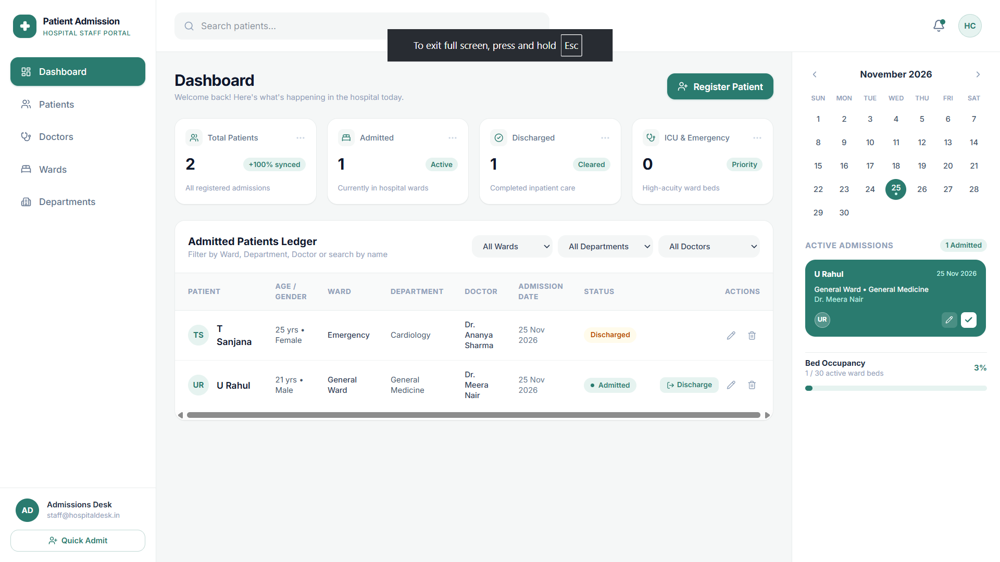
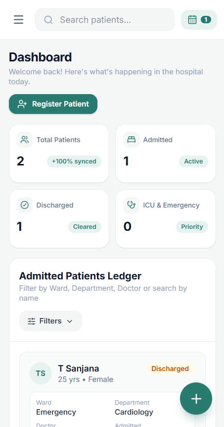

# Patient Admission Management App

A full-stack hospital patient admission management web application built for the **DScribe Software Engineer Intern — Round 1 Task**.

## Live Links
- **Live Application (Frontend):** https://dscribe-patient-management-lyart.vercel.app
- **Backend API (Render):** https://dscribe-patient-management-nfqk.onrender.com
- **GitHub Repository:** https://github.com/phaneesh4125/dscribe-patient-management

> *Note: The backend is hosted on Render's free tier and may take ~30 seconds to wake up on the first request after inactivity.*

## Tech Stack
- **Frontend:** React.js (v19), Vite, Tailwind CSS, Axios, Lucide React
- **Backend:** Python, Flask, Flask-SQLAlchemy, Flask-CORS, Gunicorn
- **Database:** PostgreSQL (Neon) in production, SQLite for local development
- **Deployment:** Vercel (Frontend), Render (Backend), Neon (Database)

## Features
- **Admit Patients:** Register new patient admissions with 8 required fields (Patient Name, Age, Gender, Ward, Department, Doctor, Admission Date, and Status).
- **Dashboard & Ledger:** View all admitted and discharged patients alongside live KPI summary metrics and ward bed occupancy.
- **Search & Filtering:** Search patients by name in real time and filter by **Ward**, **Department**, **Doctor**, or admission date.
- **Full CRUD & Discharge:** Edit existing patient details, mark patients as **Discharged**, and delete records with a confirmation dialog.
- **Dual-Layer Validation:** Enforces letters-only names, age `0–120`, valid dropdown options, and non-future admission dates on both the React frontend and Flask backend (`HTTP 400` on invalid input, `HTTP 404` on missing records).
- **Responsive Design:** Adapts cleanly across desktop, tablet, and mobile viewports.

## Screenshots

### Desktop Dashboard


### Register Patient Modal


### Mobile View


## Steps to Run Locally

### 1. Clone the Repository
```bash
git clone [https://github.com/phaneesh4125/dscribe-patient-management.git](https://github.com/phaneesh4125/dscribe-patient-management.git)
cd dscribe-patient-management
```

### 2. Start the Backend (Python / Flask)
```bash
cd backend
python -m venv venv
# Windows:
venv\Scripts\activate
# macOS/Linux:
# source venv/bin/activate

pip install -r requirements.txt
python app.py
```
The Flask API starts on `http://127.0.0.1:5000` and automatically uses a local SQLite database (`patients.db`) when `DATABASE_URL` is not configured.

### 3. Start the Frontend (React / Vite)
Open a second terminal:
```bash
cd frontend
npm install
npm run dev
```
The React app starts on `http://localhost:5173`.